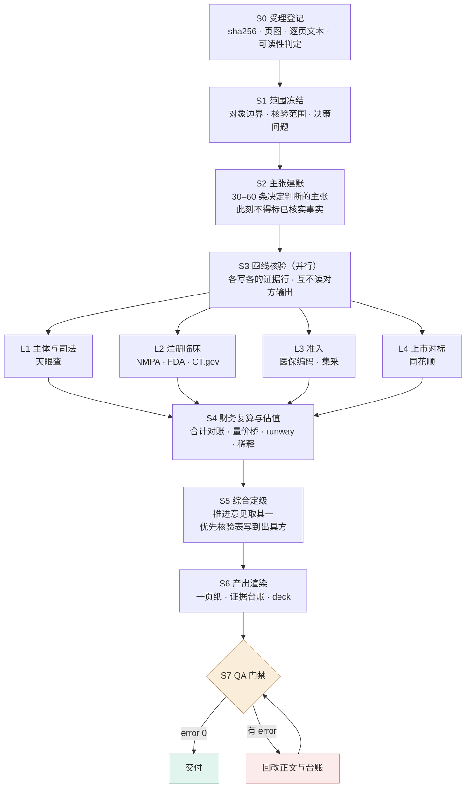

# meddev-invest-research

**医疗器械 BP 审查工作流**：把一份商业计划书变成可追溯的初筛意见——每条判断都能追到 BP 页码或原始来源，每个未核验项都写明找谁拿。

当前版本 0.3.5（2026-11-20）· [MIT 许可](LICENSE) · 适配任意 skills-compatible runtime

## 它解决什么问题

医疗器械投资判断最容易出的错，不是看不懂技术，而是**把不成立的东西当成结论**：

- 公司说"已获三类证"，于是当成"临床优效"——实际获证只证明准入门槛过了；
- 天眼查免费档查不到司法记录，于是写成"无诉讼风险"——实际只是权限不够；
- 一份 BP 里市场数字前后差 2 倍，报告直接引用其中好看的那个；
- 尽调清单写着"需提供注册证"，但没写找谁拿，这份清单交不出去。

这个仓库把这些错误变成**机器可拦的检查**，再把剩下的判断交回研究者。

## 工作流总览

八阶段流水线，每阶段有明确门禁；**不过门禁就回改，不允许绕过**。



<details>
<summary>各阶段门禁一览</summary>

| 阶段 | 门禁 |
|---|---|
| S0 | 文本抽取为空的页必须看原图；记"无法识读"，不得写成"未披露" |
| S1 | 不得混用"材料初筛"与"已执行核验"两种口径 |
| S2 | 此刻标"已核实事实"是错的——真核验在 S3，核完再改 |
| S3 | 子 Agent 之间不得互读输出，否则同一判断会被误当独立验证 |
| S4 | 倍数不等于估值结论；亏损公司 PS 不与盈利同行并列 |
| S5 | 推进意见四选一且只能一个；优先核验表必须写到出具方 |
| S6 | 交付形态可按宿主能力降级，但结论与引用不得改 |
| S7 | 不通过就回改正文与台账，不得只交"引用有问题"的说明 |

</details>

## 核心机制：四态主张与证据契约

每条判断都要归入四态之一，不允许含糊：

| 主张状态 | 含义 | 机器检查 |
|---|---|---|
| 公司声称 | 材料给出，但未取得覆盖该主张的验证 | 可以"支持"，但不构成独立确认 |
| 已核实事实 | 实际查看的原始证据在所述范围内支持 | **必须有证据ID**；不得配"不支持/无法核验"；否定型断言不得标此项 |
| 测算或推断 | 列出输入、方法、单位、假设 | **必须记录假设**，否则阻断 |
| 未披露或待核验 | 说清是材料未提供、识读失败、来源不支持还是冲突 | 必须有下一步核验 |

配套的来源表记录"从哪里得到"（五类来源、同源组、访问日期、适用范围与局限），主张表记录"它能支持什么"。两表通过 `evidence_id` 关联，引用不存在的 ID 直接阻断。

## 四条核验线

| 线 | 查什么 | 工具 | 未授权时的降级 |
|---|---|---|---|
| L1 主体与司法 | 工商登记、股东实控、司法诉讼、被执行、行政处罚、经营异常 | 天眼查 `tyc-mcp` | 标"未核验"，不写成"无记录" |
| L2 注册临床 | NMPA/CMDE 注册证与创新通道、FDA 510(k)/PMA、ClinicalTrials、关键文献 | WebFetch + WebSearch 落到官方原文 | 标"未执行" |
| L3 准入 | 医保编码、收费项目、支付范围、集采中选价、挂网价、DRG/DIP | 医保局、编码平台、省级集采文件 | 标"未执行" |
| L4 上市对标 | 可比公司 PE/PS/PB、财务三表与指标 | 同花顺 `hithink-finance` | 估值只做定性，不给倍数 |

连接器都是**可选增强**。没有它们流程照样跑完，只是对应线标"未核验"——**降级不等于降低判断强度，但要如实披露**。

## 它明确不做什么

这些边界比功能更重要，因为它们决定了这份报告的效力：

- **不给投资总分、不评分、不打灯号。** 投资判断不能压缩成一个数字。
- **不承诺回报或 IPO 时间。** 退出是路径与条件分析，不是预言。
- **不把材料初筛说成已完成尽调。** 只有实际执行且有证据的核验才能写成尽调。
- **不编造未提供的信息。** 缺什么就写缺什么，并说明对判断的影响。
- **不做行业排名断言。** "行业第一"这类说法只能作为公司声称出现，且必须标注无来源。

## 本版变化

- 支持多 runtime：S4／S6 不再绑定 WorkBuddy 专有工具，安装脚本支持六种 runtime 目录；
- 新增 BP 初筛自动化工作流：S0 受理 → S1 范围冻结 → S2 主张建账 → S3 四线核验 → S4 财务复算 → S5 综合定级 → S6 渲染 → S7 QA 门禁；
- 四条核验线：主体与司法（天眼查）、注册临床（NMPA/FDA/ClinicalTrials）、准入（医保局/集采）、上市公司对标（同花顺）；
- 本地脚本：受理登记、台账导出、交付门禁、批量排队；脚本不写判断，只做转换与一致性校验；
- 一份证据契约：来源类型、主张核验状态、支持范围分别记录，历史/预测与实际分开；
- 明确BP初筛与已执行尽调的边界，不用信号灯或固定条数替代证据；
- 按器械类型选择临床信息，拆开编码、收费、支付、采购、入院与回款；
- 财务估值按业务与阶段处理，补里程碑资金、延期情景和关键未知；
- 引文检查必须反馈修改正文与推进意见；
- 关键图表与主张逐项对应，复算金额与比例，保留无法解释的口径差异；
- 默认单Agent；并行与专用数据工具是可选能力。

升级内容与验证边界见[版本记录](CHANGELOG.md)。

## 连接器依赖

工作流用到两个已授权连接器，均为可选但显著提升核验强度：

| 连接器 | 用途 | 未授权时的降级 |
|---|---|---|
| 天眼查 `tyc-mcp` | 工商登记、股东与实控、司法诉讼、被执行、行政处罚、经营异常 | L1 标"未核验"，报告写明主体与司法未查 |
| 同花顺 `hithink-finance` | A 股财务三表、指标、估值倍数 | L4 标"未执行"，估值只做定性，不给倍数 |

两者都基于公开数据，**不构成对 BP 披露内容的独立交叉验证**。权益档位、限流、未授权的空结果，与"确实无记录"必须分开记录。

## 入口与结构

- [SKILL.md](SKILL.md)：主入口与按需路由；
- references/：统一证据、范围精炼、领域研究及综合验证；
- assets/templates/：初筛/memo骨架、来源及主张表；
- [workflows/bp-screening.md](workflows/bp-screening.md)：BP初筛自动化工作流的编排层（受理→范围→建账→三线核验→复算→综合→渲染→QA）；
- scripts/：intake 受理登记、export_ledger 台账导出、qa_gate 交付门禁、batch 批量受理；
- commands/meddev-invest.md：主命令内容；
- skills/*/SKILL.md：兼容旧角色名称，依赖整个仓库；
- [evals/README.md](evals/README.md)：合成行为用例与验证方法。

本仓库是指令、模板与本地脚本，不包含数据库爬取、Agent调度程序或财务审计软件。脚本只做无损转换与机器校验，判断仍由研究者按 references 执行。NMPA专用skill、PDF解析器不是强制依赖；使用宿主可用工具并披露覆盖与失败。无专用工具时仍可进行材料初筛。

## 自动化工作流

BP 初筛已有固定流程，见 [workflows/bp-screening.md](workflows/bp-screening.md)。四段命令：

```bash
# 1. 受理登记（一份）
python3 scripts/intake.py "<BP.pdf>" --out outputs/<case_id> --case-id intake

# 2. 批量受理与排队（多份，按 sha256 去重）
python3 scripts/batch.py --inbox "~/Desktop/项目- BP&资料" --out outputs

# 3. 台账导出（跑完主张表与来源表之后）
python3 scripts/export_ledger.py --run outputs/<case_id>

# 4. 交付门禁（不通过就回改，不要绕过）
python3 scripts/qa_gate.py --run outputs/<case_id> --check-page-content
```

依赖：`python3`、`pymupdf`、`openpyxl`、`Pillow`（`python3 -m pip install pymupdf openpyxl pillow`）。

安装：`./scripts/install.sh` 自动探测本机已有的 runtime，也可指定目标。本仓库是单一来源，被安装的目录是部署副本；改动改仓库后重跑脚本，不要直接改副本。

```bash
./scripts/install.sh                  # 自动探测：workbuddy → dsh → claude → codex → cursor → gemini → agents
./scripts/install.sh --target dsh     # 装到指定 runtime
./scripts/install.sh --dir /path      # 装到任意路径
SKILLS_DIR=/path ./scripts/install.sh # 用通用变量覆盖，适合 CI
```

脚本不写判断：`intake.py` 只登记与渲染，`qa_gate.py` 只拦截越界与失据，推进意见始终由研究者按 references 给出。批量模式下一份 BP 用一个独立上下文，先跑完一份并入档再开下一份。

## 使用与安装

先审阅文件及权限，再在目标平台加载。最直接的方法是让Agent读取根目录SKILL.md及需要的参考文件，例如：“使用本目录的meddev-invest-research，分析这份BP并给出待核验清单。”

### 各 runtime 的技能目录

| Runtime | 技能根目录 | 说明 |
|---|---|---|
| WorkBuddy | `~/.workbuddy/skills/` | `--target workbuddy` |
| DeepSeek Harness | `~/.dsh/skills/` 或 `~/.agents/skills/` | `--target dsh` 或 `--target agents`；也可放项目级 `<项目根>/.agents/skills/` |
| Claude Code | `~/.claude/skills/` | `--target claude` |
| Codex | `~/.codex/skills/` | `--target codex` |
| Cursor | `~/.cursor/skills/` | `--target cursor` |
| Gemini CLI | `~/.gemini/skills/` | `--target gemini` |

统一形态（保持整个仓库作为一个技能目录，不要只复制 `skills/` 下的子目录）：

```text
<技能根目录>/meddev-invest-research/SKILL.md
<技能根目录>/meddev-invest-research/references/
<技能根目录>/meddev-invest-research/workflows/
<技能根目录>/meddev-invest-research/assets/
<技能根目录>/meddev-invest-research/scripts/
```

### 发现限制（重要）

`skills/` 下四个旧角色名入口位于第二层，**只扫描一层的 runtime 不会发现它们**（DeepSeek Harness 明确只认 `<root>/<name>/SKILL.md` 与 `<root>/<name>.md`；Claude Code 同理）。这类环境下直接调用主技能 `meddev-invest-research`，功能完整。

`commands/meddev-invest.md` 不是所有 runtime 都会注册为斜杠命令。技能自身默认 `user-invocable`，可用 `/meddev-invest-research` 调用。

### 可选连接器

| 连接器 | 用途 | 配置 |
|---|---|---|
| 天眼查 | 工商、股权、司法、被执行 | Streamable HTTP MCP，端点 `https://mcp.tianyancha.com/v1` |
| 同花顺 | A 股财务三表与估值倍数 | Node CLI，走 shell 工具，无需 MCP |

DeepSeek Harness 的 MCP 配置示例（`cordis.yml`）：

```yaml
- id: mcp-tyc
  name: '@deepseek-ai/dsh-mcp-client'
  config:
    serverName: tyc-mcp
    transport: streamable-http
    url: https://mcp.tianyancha.com/v1
    headers:
      Authorization: !!js '`Bearer ${process.env.TYC_TOKEN}`'
```

其余 runtime 按其 MCP 文档配置同一条目即可；工具名会是 `mcp__tyc-mcp__<tool>`，与本技能中的引用一致。未配置连接器时，对应核验线按降级规则标“未核验”，不影响其余流程。

### 验证

以实际新会话触发、相对引用读取成功、`./scripts/selftest.sh` 全过为验收。本仓库已在 WorkBuddy 上验证；其他 runtime 的安装路径与发现规则来自其公开文档，**未逐一实跑验证**。

## 私有项目与许可

BP、身份资料、非公开财务、案例原始输出与评审表留在用户授权的本地位置，不随 skill 提交或外发。外部检索仅用必要公开信息，不自动联系项目方或付费注册。仓库内的测试夹具一律为合成数据，公司名与产品均为虚构，不含任何真实交易信息。

### 许可

[MIT](LICENSE) © 2026 cniven1978

可自由使用、修改、商用、闭源分发，只需保留版权与许可声明。不提供任何担保。

本仓库的研究方法为原创整理，未复制第三方模板或样式文件。

研究输出供用户决策支持，**不替代最终投资判断或相应专业核验**。许可证只授权本仓库的代码与文档，不构成对任何投资建议、数据来源或第三方内容的授权。
